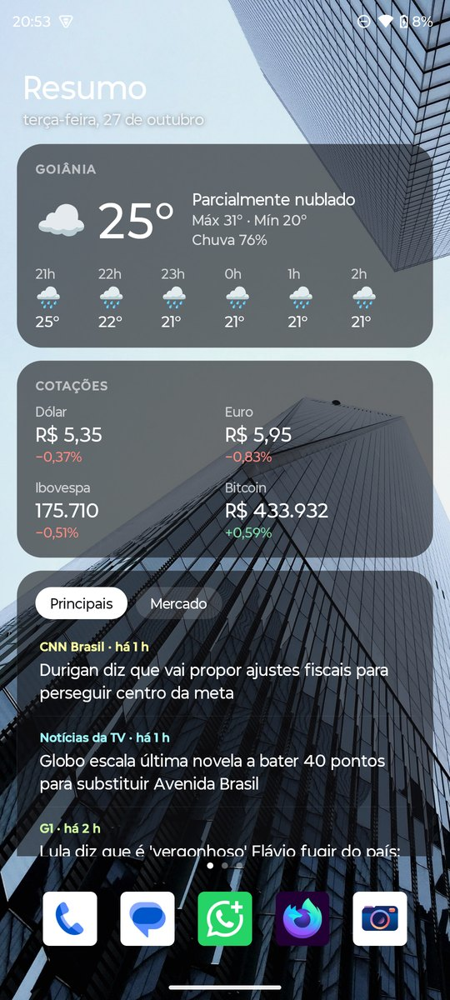
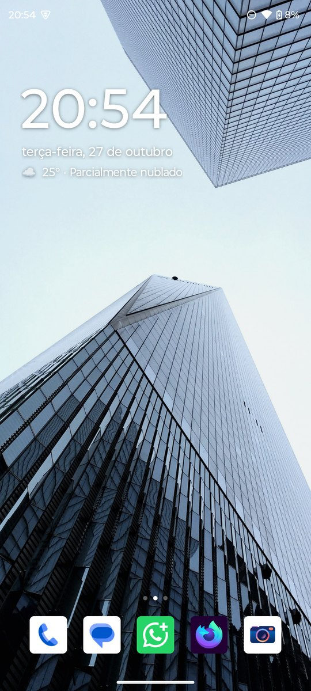
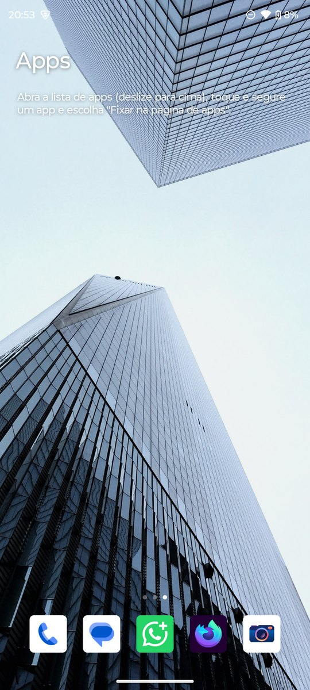
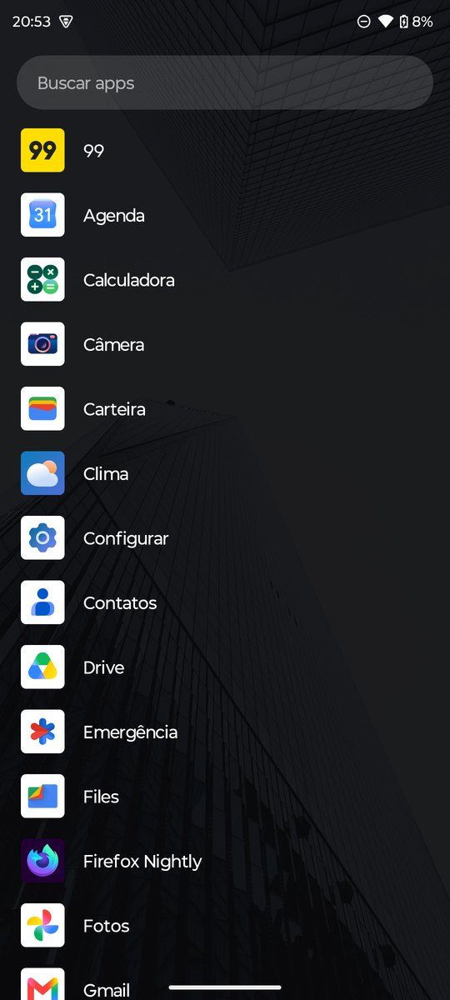

# moto g15: debloat por ADB e o launcher Leve

Deixe o **moto g15** mais leve em duas etapas, sem root:

1. **Debloat por ADB.** O script remove do seu usuário 45 apps de anúncio, rastreamento, teste de fábrica e extras da Motorola. Dá para desfazer com um comando.
2. **Leve, um launcher de 44 KB.** Tem três páginas (widgets, relógio e apps), uma lista de apps com busca e nenhum serviço rodando em segundo plano.

<p align="center">
  
  
  
  
</p>

Testado no moto g15 (`lamu_g`), Android 15, build `VVTA35.51-124`. Depois do debloat, a RAM livre com o celular parado subiu de ~1,4 GB para ~1,8 GB.

---

## 1. Conectar o celular por ADB (sem cabo)

Você precisa do [Android SDK Platform-Tools](https://developer.android.com/tools/releases/platform-tools) (`adb`) no computador, e o celular precisa estar no mesmo Wi-Fi.

1. **Configurações → Sobre o telefone →** toque 7 vezes em **Número da versão**.
2. **Configurações → Sistema → Opções do desenvolvedor →** ative **Depuração por Wi-Fi**.
3. Toque em **Depuração por Wi-Fi → Parear dispositivo com código** e deixe essa tela aberta.
4. No computador, rode os comandos abaixo. As portas de pareamento e de conexão são diferentes, e as duas aparecem no celular.

```sh
adb pair 192.168.0.X:PORTA_DE_PAREAMENTO CODIGO
adb connect 192.168.0.X:PORTA_DE_CONEXAO
adb devices
```

## 2. Debloat

```sh
cd debloat
./debloat.sh                          # mostra o que sairia, sem remover nada
./debloat.sh --aplicar                # remove a lista padrão
./debloat.sh --aplicar --opcionais    # remove também os opcionais
```

- **Sem root:** usa `pm uninstall -k --user 0`. O app sai do seu usuário e o APK continua na partição do sistema. Uma restauração de fábrica traz tudo de volta.
- **Backup:** antes de remover, salva a lista completa de pacotes (`antes-*.txt`) e o que foi removido (`removidos-*.txt`).
- **Desfazer:** `./restaurar.sh removidos-AAAAMMDD-HHMMSS.txt`. Sem argumento, restaura todos das duas listas.
- **Mais de um aparelho conectado:** use `ADB_DEVICE=ip:porta ./debloat.sh ...`.

### O que sai

A lista completa, comentada linha por linha, está em [`debloat/pacotes.txt`](debloat/pacotes.txt). A base foi a classificação do [Universal Android Debloater Next Generation](https://github.com/Universal-Debloater-Alliance/universal-android-debloater-next-generation): só entraram pacotes marcados como **Recomendado**, mais dois anúncios que o UAD não conhece.

| Grupo | Exemplos |
|---|---|
| Anúncios e instaladores de propaganda | Glance (tela de bloqueio), InMobi Weather, Mobile Services Manager, MotoApps, App Box |
| Facebook embutido | App Manager, Services, instalador |
| Anúncios e rastreamento do Google | AdServices, FederatedCompute, OnDevicePersonalization, Feedback |
| Motorola | Notificações promocionais, Moto Care, Ajuda, Modo demo, ThinkShield, Moto Secure, Gametime, Lenovo ID |
| Testes de fábrica | Teste de digital, CQATest, sensores e logs MediaTek, Rastreamento do sistema |
| Só para a primeira configuração | Restaurar backup, inicializador |
| Outros | Google TV, Google One, Family Link, Chromebook streaming |

**Opcionais**, em [`debloat/pacotes-opcionais.txt`](debloat/pacotes-opcionais.txt): Android Auto, Bem-estar digital, App Google (barra de pesquisa, Discover e "Ok Google") e Chrome. Apague do arquivo as linhas do que você usa. Se você remover o Chrome, os web apps instalados por ele param de abrir.

### O que não sai

Ficam no aparelho:
- discador, contatos, SMS, câmera, teclado, Play Store, Play Services, WebView e atualizações do sistema;
- os pacotes `com.ape.*`, `com.tinno.*` e `com.myos.*`, da Tinno, que monta o aparelho para a Motorola. O UAD não os classifica, e mexer neles é arriscado;
- `com.motorola.paks` e `com.motorola.paks.notification`, que o sistema protege e não deixa remover sem root.

[`debloat/pacotes-sistema-moto-g15.txt`](debloat/pacotes-sistema-moto-g15.txt) traz todos os 280 pacotes de sistema de fábrica, para consulta.

> Use por sua conta e risco. Mesmo reversível, remover um pacote pode afetar alguma função que você usa. Rode antes sem `--aplicar` e leia a lista.

---

## 3. Leve: o launcher

| Página | O que tem |
|---|---|
| **← Resumo** | Clima (agora, máxima e mínima, chuva, próximas 6 horas), cotações (dólar, euro, Ibovespa, bitcoin) e notícias com abas *Principais* e *Mercado*. Tocar abre a notícia. |
| **Início** | Relógio grande, data e uma linha com o clima. O relógio abre os alarmes, e a data abre a agenda. |
| **Apps →** | Grade com até 24 apps fixados. |

- **Deslizar para cima:** abre a lista de apps em ordem alfabética, com busca sem acento e rolagem rápida por letra. A tecla *Ir* abre o primeiro resultado.
- **Deslizar para baixo:** abre as notificações.
- **Toque longo num app:** favoritar na barra de baixo (até 5), fixar na página de apps, ver informações ou desinstalar.
- **Toque longo no fundo:** papel de parede e configurações.
- **Botão Início:** volta ao relógio.

**Por que é leve:**
- Java puro, sem AndroidX e sem nenhuma biblioteca. O APK tem 44 KB.
- Nenhum serviço, alarme ou job. Os dados só são buscados com a tela inicial aberta e só quando estão velhos: notícias a cada 15 min, cotações a cada 5 min, clima a cada 30 min. A última resposta fica guardada para aparecer na hora e sem internet.
- Ícones carregados uma vez, fora da thread principal.
- Fontes sem chave de API: [Open-Meteo](https://open-meteo.com) (clima), [AwesomeAPI](https://docs.awesomeapi.com.br) (moedas), Yahoo Finance (Ibovespa) e Google News RSS (notícias).

O clima é de **Goiânia**. Para mudar a cidade, troque `LAT`, `LON` e `CITY` em [`leve/app/src/io/leve/Feeds.java`](leve/app/src/io/leve/Feeds.java). Assim o launcher não precisa pedir permissão de localização.

### Instalar

Baixe o `Leve.apk` em [Releases](../../releases) ou compile você mesmo (veja abaixo). Depois:

```sh
adb install -r Leve.apk
adb shell cmd role add-role-holder --user 0 android.app.role.HOME io.leve
```

Se preferir, no celular: **Configurações → Apps → Apps padrão → App de tela inicial → Leve**. Para voltar ao launcher da Motorola, escolha ele no mesmo lugar.

### Compilar

Não usa Gradle. Você precisa de um JDK 17+ e do Android SDK (build-tools 34 e platform android-34).

```sh
cd leve
ANDROID_HOME=/caminho/do/android-sdk ./build.sh
```

Na primeira vez, o script cria uma chave própria em `leve/leve.keystore`. Guarde esse arquivo: as próximas atualizações precisam da mesma chave.

---

## Licença

[MIT](LICENSE)
